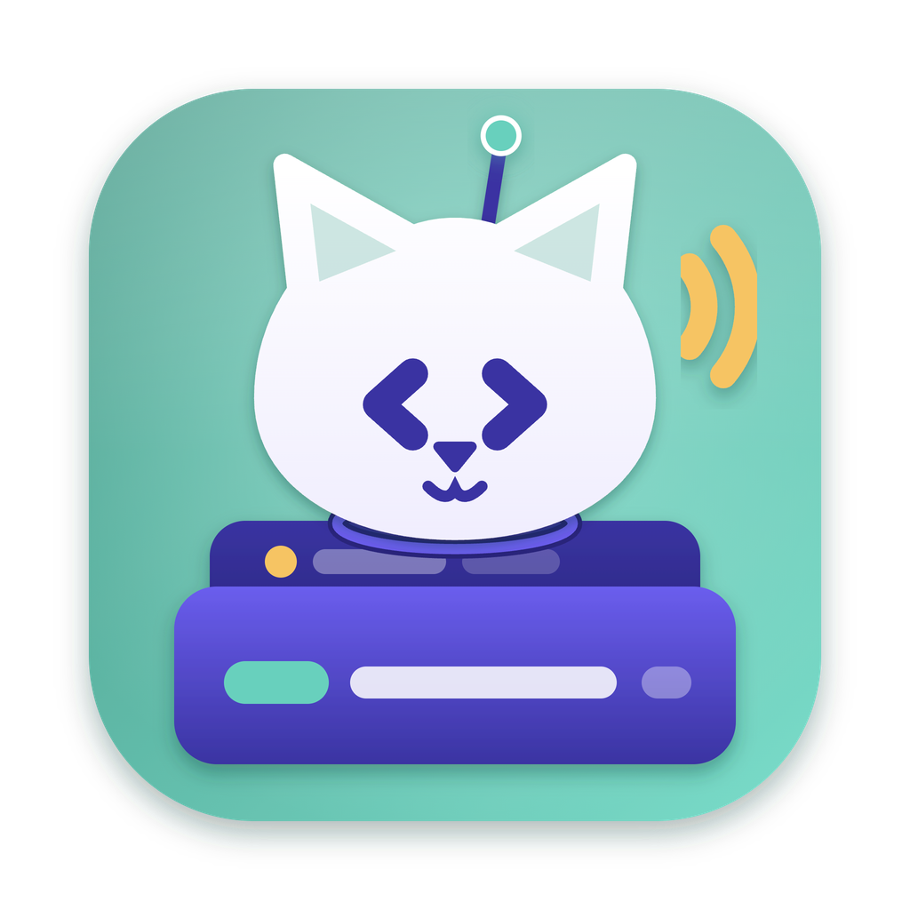

<p align="center"></p>

<h1 align="center">DialCatz</h1>
<p align="center"><em>Dial an endpoint. Hear it purr.</em></p>
<p align="center">
  <a href="https://catzoid.com/dialcatz">Website</a> ·
  <a href="https://catzoid.com/dialcatz/download">Download</a> ·
  <a href="https://catzoid.com/docs">Docs</a> ·
  <a href="https://catzoid.com/community">Community</a>
</p>

An API client for macOS, Windows and Linux: REST, GraphQL and WebSocket requests, collections, environments, scripts, tests and a runner — and your team’s own server, [DialCatz Den](https://github.com/catzoidhub/DialCatz-Den), when you want to share them.

Part of [Catzoid](https://catzoid.com) — free, open-source developer tools with nine lives. All cats, no catch: no
account, no Pro tier, nothing locked behind a payment.

## What it does

- **Requests** — REST, GraphQL and WebSocket; params, headers, auth, bodies (JSON, form, multipart, binary); paste a cURL command and it becomes a request.
- **Collections and environments** — folders, variables, pre-request and test scripts, a runner with iterations; results export as JSON or JUnit XML.
- **Import** — Postman collections and data exports, Postman workspaces with an API key, OpenAPI / Swagger, cURL.
- **Teams** — a self-hosted [DialCatz Den](https://github.com/catzoidhub/DialCatz-Den): live sync, invite links instead of accounts, environment values that stay on each computer. Or share through Git: a workspace kept as files in your repository.
- **AI, optional** — explain a response, write tests, generate a body; names and URLs only, never your secrets.
- **The family** — every [DevCatz](https://github.com/catzoidhub/DevCatz) site is an environment; Check in DBCatz opens the table a request touched.

## Install

Download the DMG from [catzoid.com/dialcatz/download](https://catzoid.com/dialcatz/download) — it picks the right
build for your Mac (Apple silicon or Intel, macOS 13 or later). Or with Homebrew — it asks you to trust a tap
that is not its own the first time:

```bash
brew tap catzoidhub/catz && brew trust catzoidhub/catz
brew install --cask dialcatz
```

The app is signed and notarized by Apple and updates itself (Settings → About → Check for Updates).

Windows 10 / 11 (x64): `DialCatz-Setup-<version>.exe` from the same page or the
[latest release](https://github.com/catzoidhub/DialCatz/releases/latest). It installs for your account only, no
administrator rights needed, and updates itself too. It is not code-signed yet (see Code signing below).

Linux (x64): `DialCatz-<version>-x64.AppImage` or `DialCatz-<version>-amd64.deb` from the same page or the
[latest release](https://github.com/catzoidhub/DialCatz/releases/latest). The AppImage offers to install itself into
`~/Applications` with a menu entry on its first run; the `.deb` suits Ubuntu and Debian. Neither is signed yet.

## Build from source

```bash
bun install
bun run dev          # run it in development
bun run typecheck
bun run package      # a signed DMG in dist/ (notarized when a notarytool profile is set up)
```

Found a bug? Use **Help → Report a Bug…** in the app, or [open an issue](https://github.com/catzoidhub/DialCatz/issues).

## Code signing

macOS builds are signed with a Developer ID and notarized by Apple. **The Windows installer is not code-signed yet**:
the SignPath Foundation, which signs open-source projects for free, asks for a project with more history and public
use than DialCatz has today, and paid certificates are out of reach for now. Windows SmartScreen therefore warns when you
open the installer: choose **More info → Run anyway**. The installer is built by GitHub Actions from this repository,
so what you run is this source. Linux packages are built by GitHub Actions from this repository too, and are not signed either. Stars, issues and pull requests help DialCatz qualify for free signing later. Policy:
[catzoid.com/legal/code-signing](https://catzoid.com/legal/code-signing).

## How it is made

DialCatz is made by one person, with two others helping, and its code is written together with
[Claude by Anthropic](https://www.anthropic.com/claude), an AI assistant. They decide what the cat does, designs
it, tries every feature on a real computer and reviews every change before it ships — Claude writes and explains the
code with them. Every commit Claude helped with says so (`Co-Authored-By: Claude`), so you can read, test or question
any of it. Found something that looks wrong? Open an issue — a person reads every report.

Catzoid is an independent project; it is not made, sponsored or endorsed by Anthropic.

## Licence

DialCatz is free software: you can redistribute it and/or modify it under the terms of the GNU General Public License
as published by the Free Software Foundation, version 3. It comes with no warranty. See [`LICENSE`](LICENSE).

The names Catzoid and DialCatz and the Catzoid cat are trademarks and are **not** covered by the licence: a fork must
use its own name and icon. See [`TRADEMARKS.md`](TRADEMARKS.md).

Contributions are welcome — see [`CONTRIBUTING.md`](CONTRIBUTING.md). Before your first pull request is merged you
sign the [contributor licence agreement](CLA.md) through the CLA check on the pull request — you keep the copyright of
your work. Questions and bug reports: [`SUPPORT.md`](SUPPORT.md); security problems, privately: [`SECURITY.md`](SECURITY.md).

Copyright © 2026 Mahryan Rakhmatullah
