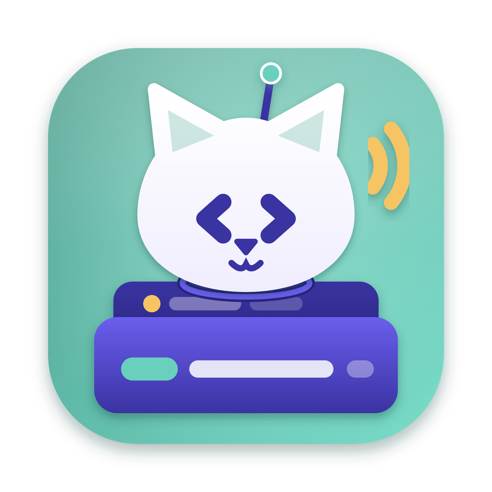

<p align="center"></p>

<h1 align="center">DialCatz</h1>
<p align="center"><em>Dial an endpoint. Hear it purr.</em></p>
<p align="center">
  <a href="https://catzoid.com/dialcatz">Website</a> ·
  <a href="https://catzoid.com/dialcatz/download">Download</a> ·
  <a href="https://catzoid.com/docs">Docs</a> ·
  <a href="https://catzoid.com/community">Community</a>
</p>

An API client for macOS: REST, GraphQL and WebSocket requests, collections, environments, scripts, tests and a runner — and your team’s own server, [DialCatz Den](https://github.com/catzoidhub/DialCatz-Den), when you want to share them.

Part of [Catzoid](https://catzoid.com) — free, open-source developer tools with nine lives. All cats, no catch: no
account, no Pro tier, nothing locked behind a payment.

## What it does

- **Requests** — REST, GraphQL and WebSocket; params, headers, auth, bodies (JSON, form, multipart, binary); paste a cURL command and it becomes a request.
- **Collections and environments** — folders, variables, pre-request and test scripts, a runner with iterations; results export as JSON or JUnit XML.
- **Import** — Postman collections and data exports, Postman workspaces with an API key, OpenAPI / Swagger, cURL.
- **Teams** — a self-hosted [DialCatz Den](https://github.com/catzoidhub/DialCatz-Den): live sync, invite links instead of accounts, environment values that stay on each Mac.
- **AI, optional** — explain a response, write tests, generate a body; names and URLs only, never your secrets.
- **The family** — every [DevCatz](https://github.com/catzoidhub/DevCatz) site is an environment; Check in DBCatz opens the table a request touched.

## Install

Download the DMG from [catzoid.com/dialcatz/download](https://catzoid.com/dialcatz/download) — it picks the right
build for your Mac (Apple silicon or Intel, macOS 13 or later). Or with Homebrew:

```bash
brew install --cask catzoidhub/catz/dialcatz
```

The app is signed and notarized by Apple and updates itself (Settings → About → Check for Updates). Windows builds
are on the way.

## Build from source

```bash
bun install
bun run dev          # run it in development
bun run typecheck
bun run package      # a signed DMG in dist/ (notarized when a notarytool profile is set up)
```

Found a bug? Use **Help → Report a Bug…** in the app, or [open an issue](https://github.com/catzoidhub/DialCatz/issues).

## Licence

DialCatz is free software: you can redistribute it and/or modify it under the terms of the GNU General Public License
as published by the Free Software Foundation, version 3. It comes with no warranty. See [`LICENSE`](LICENSE).

The names Catzoid and DialCatz and the Catzoid cat are trademarks and are **not** covered by the licence: a fork must
use its own name and icon. See [`TRADEMARKS.md`](TRADEMARKS.md).

Contributions are welcome. Before your first pull request is merged you sign the
[contributor licence agreement](CLA.md) through the CLA check on the pull request — you keep the copyright of your
work.

Copyright © 2026 Mahryan Rakhmatullah
