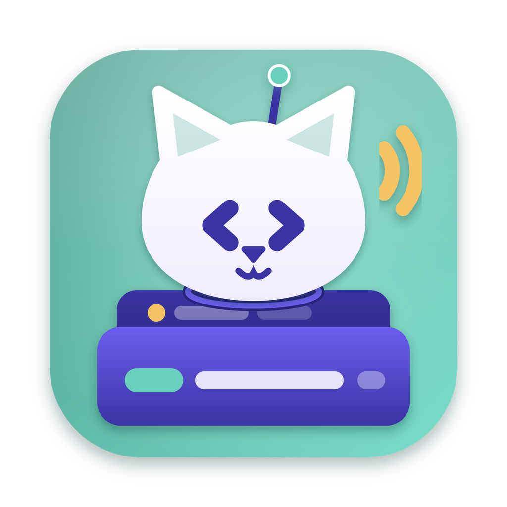

<p align="center"></p>

<h1 align="center">DialCatz</h1>
<p align="center"><em>Dial an endpoint. Hear it purr.</em></p>
<p align="center">
  <a href="https://catzoid.com/dialcatz">Website</a> ·
  <a href="https://catzoid.com/dialcatz/download">Download</a> ·
  <a href="https://catzoid.com/docs">Docs</a> ·
  <a href="https://catzoid.com/community">Community</a>
</p>

An API client for HTTP, GraphQL and the live protocols — WebSocket, Socket.IO, Pusher, gRPC, Server-Sent Events and JSON-RPC — on macOS, Windows and Linux. Collections can follow an OpenAPI spec, check every response against it and run it as a mock server. Share your work with your team through Git, as files in a repository you already have, or live through your team’s own server, [DialCatz Den](https://github.com/catzoidhub/DialCatz-Den).

Part of [Catzoid](https://catzoid.com) — free, open-source developer tools with nine lives. All cats, no catch: no
account, no Pro tier, nothing locked behind a payment.

## What it does

- **Requests** — every HTTP method, with params, headers, auth and bodies (JSON, form, multipart, binary, GraphQL, JSON-RPC); paste a cURL command and it becomes a request. A Server-Sent Events answer streams in as it comes.
- **Auth** — Bearer, Basic, API key and **OAuth 2.0**: authorization code with PKCE (you sign in in your browser), device code, client credentials and password, with the provider's addresses filled in from its issuer (OpenID Connect discovery). DialCatz gets the token when you send and renews it by itself; tokens stay on your computer, encrypted, never in the collection. **Client certificates** (mutual TLS) per host, PEM or PKCS#12, for requests, WebSocket and gRPC.
- **Other protocols** — pick one from the request-kind menu: WebSocket; Socket.IO; Pusher for Reverb, Sockudo, Soketi or Pusher Channels, with private and presence channels signed from a `{{variable}}`; gRPC through server reflection or your `.proto` files.
- **OpenAPI** — a collection follows its spec (a file, a URL, a DevCatz site or a DoCatz service) and a review dialog shows new, changed and gone requests before anything updates, keeping what you edited. Responses are checked against the spec in the Spec pane and in the runner. A mock server made from the spec runs on 127.0.0.1 (ports 4010–4099), and Send requests here points the collection at it. Import → OpenAPI finds the spec files in a project folder; any collection exports as OpenAPI 3.0.
- **Collections and environments** — folders, variables, pre-request and test scripts, a runner with iterations; results export as JSON or JUnit XML.
- **CLI** — run a collection's requests and tests from a terminal or a CI job, without the app: `npx dialcatz run <workspace folder | collection | OpenAPI file>`, with `--spec` to fail the build when the API drifts from its contract, data files, retries, and GitHub, HTML, JUnit or JSON reports. **Run in CI…** on a collection writes the GitHub Actions workflow or GitLab CI job. See [Command line](#command-line).
- **Import** — Postman collections and data exports, Postman workspaces with an API key, OpenAPI / Swagger, cURL.
- **Teams, two ways** — through Git, with no server: a workspace kept as small YAML files in your repository, reviewed in pull requests and shared with pull and push. Or live through a self-hosted [DialCatz Den](https://github.com/catzoidhub/DialCatz-Den): invite links instead of accounts, a teammate’s change within a second. Either way, environment values stay on each computer. [Git or DialCatz Den?](https://catzoid.com/docs/dialcatz/git#git-or-dialcatz-den)
- **AI, optional** — explain a response, write tests, generate a body; names and URLs only, never your secrets.
- **MCatzP** — let an AI assistant read your workspaces, send requests, follow specs and start mocks through [MCatzP](https://github.com/catzoidhub/MCatzP) (155 tools); anything that changes something asks in DialCatz first.
- **The family** — every [DevCatz](https://github.com/catzoidhub/DevCatz) site and [DoCatz](https://github.com/catzoidhub/DoCatz) project is an environment, with its routes, sockets and mocks; Check in DBCatz opens the table a request touched.

## Install

Download the DMG from [catzoid.com/dialcatz/download](https://catzoid.com/dialcatz/download) — it picks the right
build for your Mac (Apple silicon or Intel, macOS 13 or later). Or with Homebrew — it asks you to trust a tap
that is not its own the first time:

```bash
brew tap catzoidhub/catz && brew trust catzoidhub/catz
brew install --cask dialcatz
```

The app is signed and notarized by Apple and updates itself (Settings → About → Check for Updates).

Windows 10 / 11 (x64): `DialCatz-Setup-<version>.exe` from the same page or the
[latest release](https://github.com/catzoidhub/DialCatz/releases/latest). It installs for your account only, no
administrator rights needed, and updates itself too. It is not code-signed yet (see Code signing below).

Linux (x64 and ARM64): `DialCatz-<version>-<arch>.AppImage` or the `.deb` from the same page or the
[latest release](https://github.com/catzoidhub/DialCatz/releases/latest). The AppImage offers to install itself into
`~/Applications` with a menu entry on its first run; the `.deb` suits Ubuntu and Debian. Neither is signed yet.

## Build from source

```bash
bun install
bun run dev          # run it in development
bun run typecheck
bun run package      # a signed DMG in dist/ (notarized when a notarytool profile is set up)
```

## Command line

The CLI runs collections without the app: for a terminal, a pre-push hook or a CI job. Node 20 or later.

```bash
npx dialcatz run ./api-workspace --var baseUrl=https://staging.example.com --env-file .env.ci
npx dialcatz run shop.postman_collection.json -r cli -r junit=results.xml -r html=report.html
npx dialcatz run openapi.yaml --spec openapi.yaml --var baseUrl=http://localhost:3000
npx dialcatz run ./api-workspace -c Orders --data orders.csv --file avatar=./fixtures/cat.png
```

- `<path>` is a workspace folder (the one with `dialcatz.yml`), a collection exported from DialCatz or Postman, or an OpenAPI / Swagger file.
- Requests run in the app runner's order with their pre-request and test scripts (`dc.*` and the Postman-compatible `pm.*`), inherited auth included: HTTP in every body, Server-Sent Events, GraphQL, JSON-RPC and gRPC. WebSocket, Socket.IO and Pusher requests connect, send the first message kept with the request (Message pane → Keep with the request), listen for `--ws-wait` and give what arrived to the tests as `dc.messages`.
- OAuth 2.0 client credentials and password grants get their token by themselves; a device code sign-in is asked for when a person is at the terminal. `--cert` / `--key` or `--pfx` give a client certificate.
- A `{{name}}` takes its value from `--var name=value`, then `--env-file`, then an environment variable of the same name. Workspace folders never hold values, so secrets come from your CI's secret store.
- `--spec <file>` checks every response against an OpenAPI file (status, content type, body schema); `--data` runs once per row of a CSV or JSON file; `--file field=path` gives a multipart field (or `body=path` a binary body) its file; `--folder`, `--collection`, `--bail`, `--timeout`, `--insecure` narrow and tune the run; `--retries <n>` tries a failed request again; `--reporter cli|github|html|json|junit` (`html=report.html` says where it goes). On GitHub Actions the run's page gets a summary and an error per failed request by itself. Reports hide secret values and credential headers.
- **In CI:** a collection's menu → **Run in CI…** writes the workflow, with secrets as references to GitHub's or GitLab's own store. On GitHub there is also [DialCatz-Action](https://github.com/catzoidhub/DialCatz-Action).
- It exits 0 when everything passed, 1 when a request or a test failed, 2 when it could not start.

It is built from this repository: `bun run build:cli` writes the package to `dist-cli/` ([its README](cli/README.md)).

Found a bug? Use **Help → Report a Bug…** in the app, or [open an issue](https://github.com/catzoidhub/DialCatz/issues).

## Code signing

macOS builds are signed with a Developer ID and notarized by Apple. **The Windows installer is not code-signed yet**:
the SignPath Foundation, which signs open-source projects for free, asks for a project with more history and public
use than DialCatz has today, and paid certificates are out of reach for now. Windows SmartScreen therefore warns when you
open the installer: choose **More info → Run anyway**. The installer is built by GitHub Actions from this repository,
so what you run is this source. Linux packages are built by GitHub Actions from this repository too, and are not signed either. Stars, issues and pull requests help DialCatz qualify for free signing later. Policy:
[catzoid.com/legal/code-signing](https://catzoid.com/legal/code-signing).

## How it is made

DialCatz is made by one person, with two others helping, and its code is written together with
[Claude by Anthropic](https://www.anthropic.com/claude), an AI assistant. They decide what the cat does, designs
it, tries every feature on a real computer and reviews every change before it ships — Claude writes and explains the
code with them. Every commit Claude helped with says so (`Co-Authored-By: Claude`), so you can read, test or question
any of it. Found something that looks wrong? Open an issue — a person reads every report.

Catzoid is an independent project; it is not made, sponsored or endorsed by Anthropic.

## Licence

DialCatz is free software: you can redistribute it and/or modify it under the terms of the GNU General Public License
as published by the Free Software Foundation, version 3. It comes with no warranty. See [`LICENSE`](LICENSE).

The names Catzoid and DialCatz and the Catzoid cat are trademarks and are **not** covered by the licence: a fork must
use its own name and icon. See [`TRADEMARKS.md`](TRADEMARKS.md).

Contributions are welcome — see [`CONTRIBUTING.md`](CONTRIBUTING.md). Before your first pull request is merged you
sign the [contributor licence agreement](CLA.md) through the CLA check on the pull request — you keep the copyright of
your work. Questions and bug reports: [`SUPPORT.md`](SUPPORT.md); security problems, privately: [`SECURITY.md`](SECURITY.md).

Copyright © 2026 Mahryan Rakhmatullah
